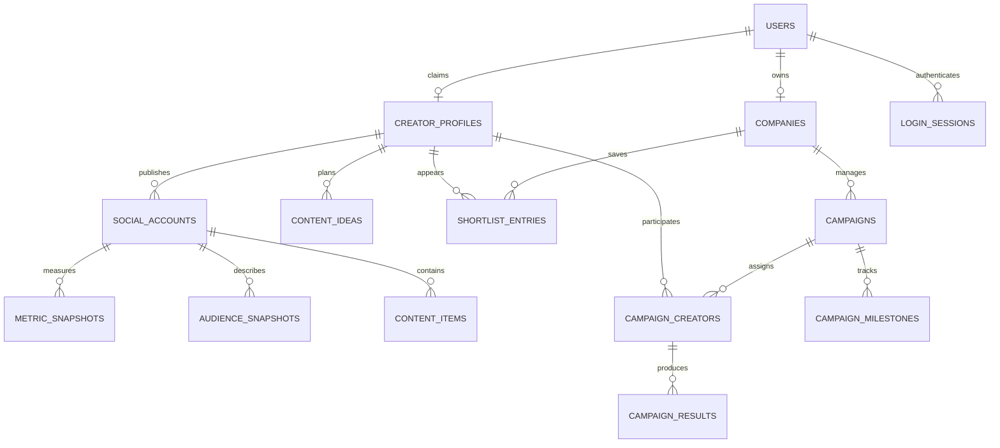

# TalentLens PostgreSQL Database

The database uses PostgreSQL 17, SQLAlchemy models, and Alembic migrations.
Prisma is not introduced because the existing backend is Python/FastAPI.
The frontend reads analytics and sample records through FastAPI. Company changes
are saved in PostgreSQL after sign-in. Legacy browser-only drafts are not imported.

## Tables

| Table | Purpose |
| --- | --- |
| users | Identity, hashed passwords, creator/brand/admin roles |
| login_sessions | Hashed, revocable session tokens and expiry |
| companies | Company identity, owner, industry, reporting contact, currency |
| creator_profiles | Optional account owner, category, location, bio, media, indicative fee |
| social_accounts | Platform, normalized handle, external identity, connection status |
| metric_snapshots | Daily followers, engagement, growth, and average reach |
| audience_snapshots | Daily location and age distributions in JSONB |
| content_items | Platform content identities, media, publication, reach, engagement |
| content_ideas | Creator-owned editorial ideas, rationale, JSONB hashtags, sample flag |
| shortlist_entries | Company-owned saved creators and notes |
| campaigns | Company-owned brief, budget, dates, objective, status, deliverables |
| campaign_creators | Unique creator assignments and agreed fees |
| campaign_milestones | Readiness steps and completion timestamps |
| campaign_results | Cumulative outcome snapshots per assignment and observation date |



## Run Locally

Start Docker Desktop first, then from the repository root:

```powershell
docker compose up -d postgres
```

Configure backend/.env using backend/.env.example. The example credentials are
for the existing local development container. Do not use them in production.
Do not overwrite an existing .env containing your configuration.

From backend:

```powershell
.\.venv\Scripts\python.exe -m alembic upgrade head
.\.venv\Scripts\python.exe -m app.seed
.\.venv\Scripts\python.exe -m alembic check
```

The default seed inserts six sample profiles, social accounts, metric and audience
snapshots, sample content and ideas. Repeated runs do not duplicate rows or overwrite
sample edits. Only --demo-workspace creates the reserved inactive demo owner;
there are no published login credentials or connected social accounts.

To add three sample campaigns and sample outcomes to an existing company:

```powershell
.\.venv\Scripts\python.exe -m app.seed --company-id YOUR_COMPANY_UUID
```

All seeded analytics and campaigns are explicitly marked is_sample=true.
Foreign-key records inherit their company or sample context from their parent.

## Constraints and Query Rules

- Monetary values use NUMERIC(14,2), represented as Decimal in Python.
- Workspace API monetary values are decimal strings to preserve exact amounts.
- Creator assignments inherit currency from their campaign. API writes must
  reconcile indicative creator currency before assigning a fee.
- Company names cannot be blank; campaign budgets must be positive and dates ordered.
- A creator appears only once in a company's shortlist or campaign.
- Social identities and daily metric/audience snapshots cannot be duplicated.
- Negative reach, followers, spend, clicks, or engagements are rejected.
- Deleting a campaign cascades to its assignments, milestones, and results.
- Deleting a creator participating in campaigns is restricted to preserve history.
- Company deletion cascades only to its owned records; shared creator data remains.
- Result snapshots are cumulative: reports must select the latest snapshot for each
  assignment, not sum snapshots across dates. Summed creator reach is not unique reach.
- JSONB audiences use arrays such as [{"country":"IN","percent":84}]. API ingestion
  must validate distribution values and totals; the database verifies the array shape.
- Workspace API queries scope company records to the signed-in brand user's
  company. Company IDs alone do not enforce authorization. Team membership and
  row-level security are not implemented.
- Social handles must be normalized by ingestion: lowercase and no leading @.
- This phase does not store OAuth credentials or scores as facts. OAuth storage,
  token encryption, scoring versioning, and real platform ingestion come next.
- updated_at is maintained by ORM updates; raw SQL writers must set it themselves.

## Verification

```powershell
.\.venv\Scripts\python.exe -m unittest discover -s tests -v
```

The offline check compares migration columns, types, foreign keys, constraints,
and indexes against the ORM schema. Live tests use a random PostgreSQL schema,
apply the actual migration chain, verify constraints and seeding, and roll the
entire test transaction back. Set TEST_DATABASE_URL to a development database:

```powershell
$env:TEST_DATABASE_URL = $env:DATABASE_URL
.\.venv\Scripts\python.exe -m unittest discover -s tests -v
```

The variables above must be set in your shell; .env loading does not populate
shell variables. Without TEST_DATABASE_URL, live tests are explicitly skipped.

## Windows Without Docker

The project-local development instance uses official EDB PostgreSQL 17 Windows
binaries extracted into `.local/postgres/runtime/pgsql`. The ignored `.local`
directory holds the runtime, data and server log. No Windows service is installed.
The server binds only to 127.0.0.1 and uses SCRAM password authentication.
The application role owns its database and is not a superuser.

Run from `backend` with a password-protected localhost DATABASE_URL in `.env`:

```powershell
.\.venv\Scripts\python.exe -m app.local_database start
.\.venv\Scripts\python.exe -m alembic upgrade head
.\.venv\Scripts\python.exe -m app.seed
.\.venv\Scripts\python.exe -m app.local_database status
.\.venv\Scripts\python.exe -m app.local_database stop
```

Start it again after a computer restart. Do not run Docker's PostgreSQL container
on the same port at the same time. This is a development instance, not a production
deployment or a replacement for backups.

## Company API

Authenticated brand accounts can read/update `/workspace/company`, browse
`/workspace/creators`, manage `/workspace/shortlist/{creator_id}`, create/read/delete
`/workspace/campaigns`, update campaign progress, and read `/workspace/results`.
The frontend uses same-origin Next.js API routes to call FastAPI, forwarding the
HttpOnly session cookie. Signed-in company changes are persisted in PostgreSQL.
`/workspace/snapshot` loads the company's data; `/workspace/sample-data` explicitly
adds sample campaigns to that company. Anonymous users see a read-only demo.

## Sample Data

```powershell
.\.venv\Scripts\python.exe -m app.seed --demo-workspace
```

This idempotent seed creates an inactive, unloginable demo identity and company,
six creator profiles, social accounts, metric/audience snapshots, four content
records and two content ideas per creator, three campaigns, their assignments
and milestones, and three sample result records. Content ideas include sample
hashtags; they are editorial fixtures, not AI-generated recommendations.

`GET /demo/workspace` reads these records from PostgreSQL, exposing only sample
creators, sample content/ideas/analytics, and the reserved demo company's sample
campaigns/results. It accepts no writes and exposes no private company data.
The company dashboard and creator preview both consume this API. No hardcoded
frontend analytics fallback is used when the backend is unavailable.

Run the backend from `backend`:

```powershell
.\.venv\Scripts\python.exe -m uvicorn app.main:app --host 127.0.0.1 --port 8000
```

Run `npm run dev` from `frontend`. The server-side API base defaults to
`http://127.0.0.1:8000`; override it with `TALENTLENS_API_URL` when needed.
